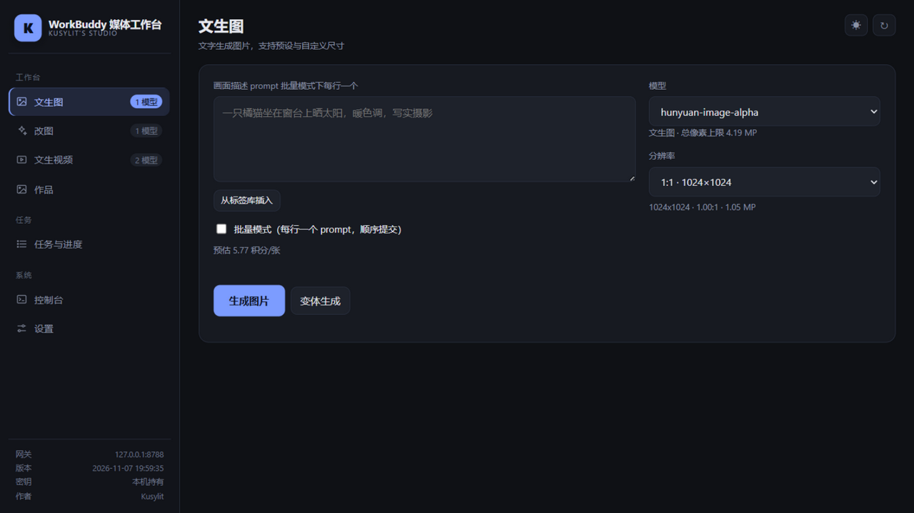

# WorkBuddy Media Workbench (Kusylit's Studio)

A local-first image / edit / video workbench plugin for **WorkBuddy2API-Hub**.

[中文说明](README.md)

It puts the gateway's media capabilities into one local page: write prompts, choose models and sizes, submit image/video jobs, watch progress, and manage generated work. Media stays on the local disk by default.



## Features

- **Text-to-image** with model, preset or custom resolution.
- **Image editing** with one or more reference images.
- **Text-to-video / image-to-video** with first frame, last frame, reference images, duration, resolution, aspect ratio and negative prompt.
- **Jobs and progress**: queued / running / saving / completed / failed states, cancel, retry-save, reuse parameters.
- **Gallery**: filter by image/video/favorites, search by filename, filter by date, favorite and delete.
- **Prompt tag library**: custom categories, search, multi-select insert, usage counters, import/export.
- **Batch queue**: one prompt per line, cost confirmation, stop control, moderation-failure stop.
- **Console / audit**: server logs, action audit, gateway health and balance.
- **Local-first**: listens on `127.0.0.1` only; media and configuration stay on your machine.

## Requirements

1. **Python 3.10+**. Standard library only; no third-party Python packages.
2. A running [WorkBuddy2API-Hub](https://github.com/ardeyouxipianyi/workbuddy2api-hub) gateway at:

   ```text
   http://127.0.0.1:8788
   ```

3. At least one enabled API key in the gateway.
4. This plugin folder must be a **sibling** of `workbuddy2api-hub`, because it reads:

   ```text
   ../workbuddy2api-hub/accounts/settings.json
   ```

Layout:

```text
your-folder/
├─ workbuddy2api-hub/
│  └─ accounts/settings.json
└─ workbuddy-media-workbench/
   ├─ media_studio.py
   ├─ media-studio.cmd
   ├─ start.sh
   └─ ...
```

## Start

### Windows

Double-click `media-studio.cmd`, or run:

```bat
python media_studio.py
```

Stop: run `media-studio-stop.cmd`, or close the console window.

### Linux / macOS

```sh
chmod +x start.sh
./start.sh
```

Or:

```sh
python3 media_studio.py
```

Stop: press `Ctrl+C` in the running terminal.

Open:

```text
http://127.0.0.1:8790/
```

## Usage

### Text-to-image

1. Open **Text to image**.
2. Write a prompt, optionally inserting tags from the tag library.
3. Choose a model and resolution. Use **Custom size** when a preset does not fit.
4. Click **Generate image**.
5. The result is saved to the configured save directory and shown below the form.

### Image editing

1. Open **Edit image**.
2. Upload one or more source images.
3. Describe the change, e.g. "change the background to a rainy street at night, keep the pose".
4. Choose model and resolution, then generate.

### Text-to-video

1. Open **Text to video**.
2. Choose a model, duration, resolution and aspect ratio.
3. Optionally provide first frame, last frame or reference images.
4. Click **Submit video job**.
5. The app switches to **Jobs & progress**. Video jobs are asynchronous and are downloaded automatically when complete.

### Jobs & progress

- Click a row to expand prompt, parameters, save path, error and preview.
- Queued video jobs can be cancelled; already running jobs usually cannot.
- Failed saves expose **Retry save** for both images and videos.
- **Reuse parameters** refills the matching form.
- **Sync history** imports existing gateway task records.

### Gallery

- Switch between **All / Images / Videos / Favorites**.
- Search supports multiple space-separated keywords; all must match the filename.
- Time filters: today, last 3/7/30 days, or a custom date range.
- Hover a work to favorite or delete it. Delete removes the file from the save directory.
- When there are more items than one page, use **Load more**.

### Tag library

- Open it from **Insert from tag library** next to a prompt field.
- Create, edit and delete tags/categories.
- Export/import tag JSON; duplicate tags are skipped on import.

### Batch queue

1. Enable **Batch mode**.
2. Put one prompt per line in the textarea.
3. Click **Import from textarea**.
4. Submit and confirm the estimated credits.
5. Use **Stop this batch** while running. Completed entries are skipped on the next run; re-import to reset statuses.

## Settings

The **Settings** page allows you to:

- Change the image/video save directory.
- Open the save directory.
- Refresh upstream balance (requires the gateway panel password).
- Enable/disable the workbench access password.
- Export/import tags.
- Inspect gateway status, model count, balance and recent audit entries.

> The access password is kept in page memory only. A refresh asks for it again; it is not written to localStorage/sessionStorage.
>
> To change the default template used by **Generate variants**, set `variant_template` in `studio-config.json`; leave it empty to use the built-in generic template. Character name keywords can be configured with the `artifact_characters` array; the default is empty.

## Runtime data

Created next to `media_studio.py`:

| Path | Purpose |
|---|---|
| `media-out/` | Generated images and videos |
| `studio-config.json` | Save directory and access-password hash |
| `studio-jobs.json` | Task history |
| `studio-tags.json` | Prompt tag library |
| `studio-favorites.json` | Gallery favorites |
| `studio-console.log` | Persistent console log |
| `studio-audit.log` | Action audit log |

These paths are ignored by `.gitignore`; do not commit them.

`studio-config.example.json` shows the initial config shape.

## Security notes

- HTTP server listens on `127.0.0.1:8790` only.
- `/api/*` requires the per-process studio token embedded in the page.
- Optional access password uses PBKDF2-SHA256; it is not persisted to disk or browser storage.
- Generated files are served through expiring HMAC-signed `/files/` URLs.
- Upstream image URLs are restricted to public `http(s)` hosts; localhost, private, link-local and cloud-metadata targets are rejected.
- Do not expose this service directly to the public internet. Put TLS, authentication and network-level rate limiting in front of it if remote access is required.

## FAQ

### "Model unavailable / 404"

Confirm the gateway is running at `127.0.0.1:8788` and has at least one enabled API key. Check the gateway dashboard for account and model state.

### A video completed but no file exists

Check **Save error** in the job detail. Common causes: unwritable save directory, full disk, or a failed download. Fix it and click **Retry save**.

### Port 8790 is in use

Run `media-studio-stop.cmd` on Windows, or stop the Python process owning 8790, then start again.

### Old works disappeared after changing the save directory

The gallery only shows the current save directory. Old files still exist; open the old folder or switch the directory back.

### The access password is requested after every refresh

Expected. The password lives only in page memory and is not restored from browser storage.

## Local checks

Before publishing, run from the repository root:

```sh
python scripts/check.py
```

On Windows you can also run `scripts/check.cmd`. It checks Python syntax, the plugin manifest, required files, shell line endings, and common secret/local-path leaks.

## Compatibility

- Gateway: WorkBuddy2API-Hub v2.0.0-compatible `/v1/media/models`, `/v1/images/generations`, `/v1/images/edits`, `/v1/videos` APIs.
- Python: 3.10+ on Windows / Linux / macOS.
- Plugin version: `1.3.2`.

## Notes

This is an independent companion workbench, not an official WorkBuddy client. WorkBuddy and WorkBuddy2API-Hub belong to their respective authors.

Author: **Kusylit**

## License

[MIT License](LICENSE)
